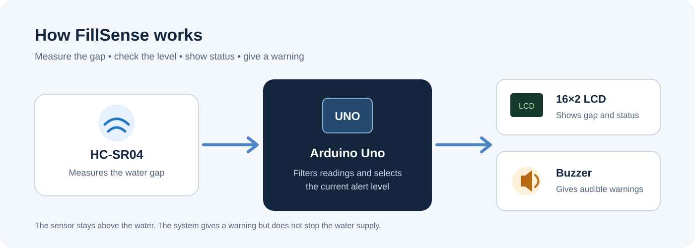

# FillSense — Water-Level Monitoring System

A small Arduino project that measures the water level without touching the water. It gives a sound warning when the water gets close to the top of a container.

**Project status:** Working prototype built. Practical test results are being added.

## Project video

[Watch the FillSense demonstration on Google Drive](https://drive.google.com/file/d/1bnug7F7jj_QptsPVGImMKt6OIEiTQtgo/view?usp=sharing)

The video is hosted on Google Drive because the file was too large to upload to GitHub. The link must be set to allow viewers with the link to open it.

## What does it do?

FillSense uses an HC-SR04 ultrasonic sensor to measure the gap between the sensor and the water surface. An Arduino Uno reads the sensor and shows the distance and status on a 16×2 LCD.

The buzzer gives a warning based on the measured gap:

| Gap from sensor to water | LCD status | Buzzer |
|---|---|---|
| More than 10 cm | SAFE | Silent |
| 5 cm to 10 cm | WARNING | One short beep every 5 seconds while water is rising |
| Less than 5 cm | CRITICAL | Continuous sound while water is rising |

When the system does not detect a clear rise in the water level for about 3 seconds, the buzzer becomes silent. The LCD still shows the current status.

The movement check uses changes in distance readings. It does not measure water flow directly.

## Main parts

- Arduino Uno
- HC-SR04 ultrasonic sensor
- 16×2 LCD (parallel, not I2C)
- Piezo buzzer
- Breadboard and jumper wires
- USB cable for power during testing

See the full [components list](hardware/components.md).

## How it works

1. The HC-SR04 sends an ultrasonic pulse towards the water.
2. The sensor measures the time taken for the echo to return.
3. The Arduino calculates the distance.
4. The program filters repeated readings to reduce sudden changes.
5. The LCD shows the gap and the current status.
6. The buzzer gives a warning when the water is rising near the top.

## Hardware connections

The project uses these Arduino Uno pins:

| Part | Arduino pin |
|---|---|
| HC-SR04 TRIG | D9 |
| HC-SR04 ECHO | D10 |
| Buzzer signal | D8 |
| LCD RS | D12 |
| LCD E | D11 |
| LCD D4 | D5 |
| LCD D5 | D4 |
| LCD D6 | D3 |
| LCD D7 | D2 |

Power and all LCD pins are listed in the [pin connection guide](hardware/pin-connections.md). The [wiring diagram](hardware/wiring-diagram.svg) gives a visual reference.

## Firmware

The Arduino sketch is in the firmware folder:

[Open FillSense.ino](firmware/FillSense.ino)

The code includes:
- Ultrasonic distance reading
- Median filtering
- Three water-level states
- Water-rise detection
- 5-second warning beeps
- Critical-level sound while the water is rising
- LCD status display
- Sensor reading error display

## Testing

The prototype should be checked at different distances using a ruler or measuring tape. Record both the ruler reading and the LCD reading.

The [testing sheet](docs/testing-results.md) is ready for real results. No accuracy value is claimed here because it must be measured on the actual build.

## Project files

| Folder | What it contains |
|---|---|
| firmware | Arduino code |
| hardware | Components, pin guide and circuit diagrams |
| docs | System design, test sheet and project limits |
| media/photos | Place for real photos of the prototype |

## Limits and safety

- This is a warning system. It does not stop the water supply.
- The HC-SR04 is not waterproof. Keep it dry and above the water.
- Water ripples and sensor position can change the readings.
- Keep the Arduino, breadboard and wires away from splashes.
- Test with a low-voltage USB supply. Do not use exposed mains wiring near water.

See [limitations and future work](docs/limitations-and-future-work.md).

## Future improvements

- Test the readings with different containers.
- Improve the sensor mounting.
- Try a waterproof sensor for a later version.
- Add saved settings for the warning distances.
- Study safe ways to control a pump in a future version.

## About this project

I built this project to learn more about sensors, Arduino programming, circuit connections and testing a real hardware system.

**Platform:** Arduino Uno  
**Language:** Arduino C++  
**Project area:** Electronics and embedded systems
