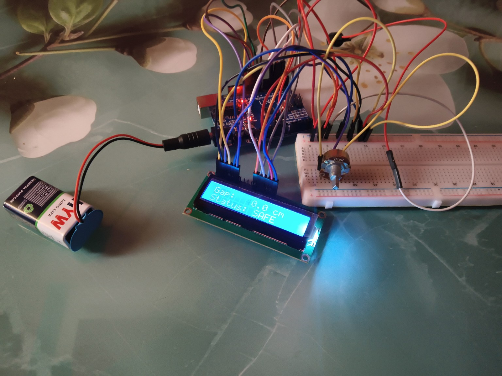
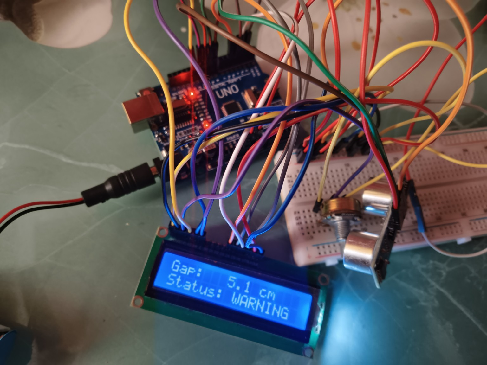
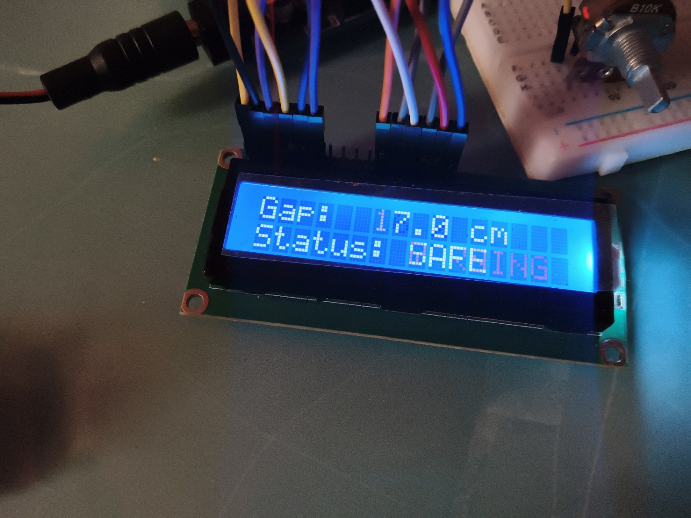

# FillSense — Water-Level Monitoring System

A small Arduino project that measures the gap between a sensor and the water surface. It gives a sound warning when the water gets close to the top of a container.

**Project status:** Working prototype built. Practical test results are being added.

## Project demonstration

[Watch the FillSense demonstration video](https://drive.google.com/file/d/1bnug7F7jj_QptsPVGImMKt6OIEiTQtgo/view?usp=sharing)

The video is hosted on Google Drive because it is too large for a normal GitHub upload. Make sure the Drive link is set to **Anyone with the link – Viewer**.

## Prototype gallery

These are photos of my actual hardware setup and LCD readings.

| Full prototype | Warning test — 5.1 cm |
|---|---|
|  |  |

**LCD close-up**

## What does it do?

FillSense uses an HC-SR04 ultrasonic sensor to measure the gap between the sensor and the water surface. An Arduino Uno reads the sensor and shows the distance and status on a 16×2 LCD.

| Gap from sensor to water | LCD status | Buzzer |
|---|---|---|
| More than 10 cm | SAFE | Silent |
| 5 cm to 10 cm | WARNING | One short beep every 5 seconds while water is rising |
| Less than 5 cm | CRITICAL | Continuous sound while water is rising |

When the system does not detect a clear rise in the water level for about 3 seconds, the buzzer becomes silent. The LCD still shows the current status. The movement check uses changes in distance readings; it does not measure water flow directly.

## Main components

- Arduino Uno
- HC-SR04 ultrasonic sensor
- 16×2 LCD (parallel, not I2C)
- Piezo buzzer
- Breadboard and jumper wires
- USB cable for testing

See [components list](hardware/components.md).

## How it works

1. The HC-SR04 sends an ultrasonic pulse towards the water.
2. The sensor measures the time taken for the echo to return.
3. The Arduino calculates the distance.
4. The program filters repeated readings.
5. The LCD shows the gap and current status.
6. The buzzer gives a warning when the water is rising near the top.

## Hardware connections

The project uses these Arduino Uno pins:

| Part | Arduino pin |
|---|---|
| HC-SR04 TRIG | D9 |
| HC-SR04 ECHO | D10 |
| Buzzer signal | D8 |
| LCD RS | D12 |
| LCD E | D11 |
| LCD D4 | D5 |
| LCD D5 | D4 |
| LCD D6 | D3 |
| LCD D7 | D2 |

See the [pin connection guide](hardware/pin-connections.md) and [wiring diagram](hardware/wiring-diagram.svg).

## Firmware

[Open FillSense.ino](firmware/FillSense.ino)

The code includes ultrasonic distance reading, median filtering, three alert states, water-rise detection, buzzer timing, LCD status display and sensor error handling.

## Testing

The [testing sheet](docs/testing-results.md) is ready for real measurements. Compare the LCD reading with a ruler and record the actual results. No accuracy value is claimed until proper tests are completed.

## Repository structure

| Folder | Contents |
|---|---|
| firmware | Arduino sketch |
| hardware | Components, pin guide and circuit diagrams |
| docs | System design, test sheet and limitations |
| media/photos | Actual prototype photographs |
| media | Demonstration video link |

## Limits and safety

- This is a warning system. It does not stop the water supply.
- The HC-SR04 is not waterproof. Keep it dry and above the water.
- Water ripples and sensor position can change readings.
- Keep the Arduino, breadboard and wires away from splashes.
- Use low-voltage USB power for testing. Keep mains wiring away from water.

See [limitations and future work](docs/limitations-and-future-work.md).

## Future improvements

- Test the readings with different containers.
- Improve the sensor mount.
- Try a waterproof sensor in a later version.
- Add saved settings for warning distances.
- Study safe pump control as a separate future version.

## About this project

I built this project to learn more about sensors, Arduino programming, circuit connections and testing a real hardware system.

**Platform:** Arduino Uno  
**Language:** Arduino C++  
**Project area:** Electronics and embedded systems
