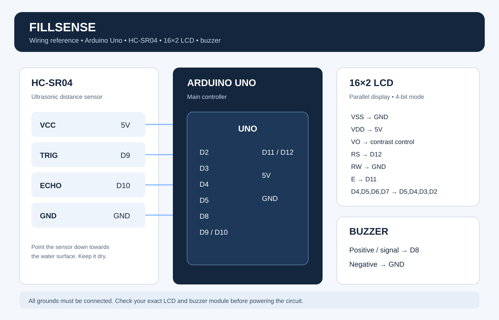

# Pin Connections

This guide matches the FillSense firmware in firmware/FillSense.ino.

## HC-SR04 ultrasonic sensor

| HC-SR04 pin | Arduino Uno |
|---|---|
| VCC | 5V |
| TRIG | D9 |
| ECHO | D10 |
| GND | GND |

## 16×2 LCD in 4-bit mode

| LCD pin | Name | Arduino connection |
|---:|---|---|
| 1 | VSS | GND |
| 2 | VDD | 5V |
| 3 | VO | Contrast adjustment; GND can be tried for a basic test |
| 4 | RS | D12 |
| 5 | RW | GND |
| 6 | E | D11 |
| 7 | D0 | Not connected |
| 8 | D1 | Not connected |
| 9 | D2 | Not connected |
| 10 | D3 | Not connected |
| 11 | D4 | D5 |
| 12 | D5 | D4 |
| 13 | D6 | D3 |
| 14 | D7 | D2 |
| 15 | A / LED+ | Backlight positive, if used |
| 16 | K / LED− | Backlight negative, if used |

For better contrast control, use a 10 kΩ potentiometer on LCD pin 3. If you do not have one, try connecting pin 3 to GND as a simple first test. The display may need a proper contrast adjustment.

Check the LCD module before wiring its backlight. Some modules have a resistor on the board and some may need an external current-limiting resistor.

## Buzzer

| Buzzer pin | Arduino connection |
|---|---|
| Positive / signal | D8 |
| Negative | GND |

This connection is for a suitable low-current piezo buzzer. Check the part marking and current rating. Do not connect an unknown high-current buzzer directly to an Arduino pin.

## Power

- Arduino 5V goes to the sensor VCC and LCD VDD.
- All parts share a common GND.
- Use USB power for basic testing.
- Keep the electronics away from the container and any water.

